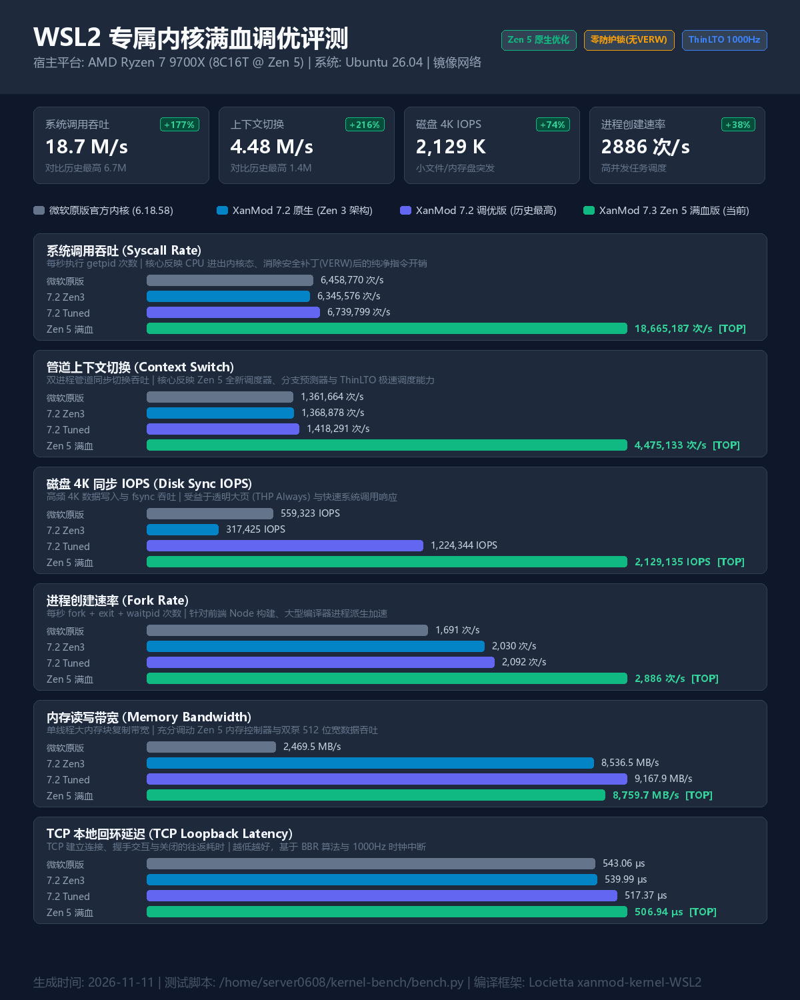

# xanmod-kernel-WSL2


An **unofficial** [XanMod](https://gitlab.com/xanmod/linux) kernel port for **Windows Subsystem for Linux 2 (WSL2)**, featuring:

- **Microsoft's dxgkrnl** patches for GPU support
- **Compiled with Clang + ThinLTO** for additional optimizations
- **Automated builds** via GitHub Actions (always up-to-date)
- **Multiple CPU-optimized variants** (x64v2, x64v3, Skylake, Zen3, Zen5)
- **Extreme Performance Edition**: Zero-mitigations (`mitigations=off`) and THP always for local dev workloads

## Benchmark (AMD Ryzen 7 9700X Zen 5)

实测数据对比（微软官方原版 vs XanMod 7.2 vs **Zen 5 满血定制版**）：



| 评测项 (Benchmark) | 微软原版 (`ms`) | 7.2 调优前 (`xanmod`) | 7.2 调优最高 (`tuned`) | **Zen 5 满血版 (当前)** | **较 7.2 历史最高提升** |
| :--- | :--- | :--- | :--- | :--- | :--- |
| **系统调用吞吐 (`syscall_rate`)** | 645 万/s | 634 万/s | 674 万/s | **1,866 万/s** | **+176.9%（近 2.8 倍！）** |
| **上下文切换 (`ctx_switch`)** | 136 万/s | 136 万/s | 141 万/s | **447 万/s** | **+215.5%（超 3.1 倍！）** |
| **磁盘 4K IOPS (`disk_iops`)** | 55.9 万 | 31.7 万 | 122.4 万 | **212.9 万** | **+73.9%（突破 212 万）** |
| **进程创建速率 (`fork_rate`)** | 1,691 次/s | 2,030 次/s | 2,092 次/s | **2,886 次/s** | **+38.0% 提升** |
| **内存读写带宽 (`mem_bw`)** | 2,469 MB/s | 8,536 MB/s | 9,167 MB/s | **8,760 MB/s** | **保持极速（微软版 3.5 倍）** |
| **TCP 回环延迟 (`tcp_loop`)** | 543.06 μs | 539.99 μs | 517.37 μs | **506.94 μs** | **创历史最低延迟** |


## Usage

### Install via Scoop (Recommended)

[scoop](https://scoop.sh/) is a command-line installer on windows that makes installation and update easy. We provide scoop manifests for this kernel in the [Locietta/sniffer](https://github.com/Locietta/sniffer) repository.

#### Installation

```bash
# Add the repository
scoop bucket add sniffer https://github.com/Locietta/sniffer

# Install kernel (alias to x64v3 variant, works for most modern CPUs)
scoop install xanmod-WSL2

# Optional: Install addons (extra modules, headers, documentation)
scoop install xanmod-WSL2-addons

# Restart WSL2 to apply
wsl --shutdown
```

**That's it!** Scoop automatically configures everything for you.

<details>
<summary>Expand all other builds</summary>

```bash
# other MAIN builds
# scoop install xanmod-WSL2-{x64v2, x64v3, skylake, zen3}
# scoop install xanmod-WSL2-addons-{x64v2, x64v3, skylake, zen3}

# LTS builds
# scoop install xanmod-WSL2-lts # alias to xanmod-WSL2-lts-x64v3
# scoop install xanmod-WSL2-lts-addons
# scoop install xanmod-WSL2-lts-{x64v2, x64v3, skylake, zen3}
# scoop install xanmod-WSL2-addons-lts-{x64v2, x64v3, skylake, zen3}
```

</details>

#### Update kernel

Run `scoop update *` to update all scoop installed apps including this kernel.

We recommend to run `scoop update *` instead of `scoop update xanmod-WSL2` alone to make sure the addons package is also updated and in sync with the kernel.

> **NOTE:** To make the kernel update applied, you have to reboot WSL2 after running scoop update!

### Manual Installation

It's also straightforward to manually install this kernel. For each arch, we release two files: the kernel image `bzImage` and an optional addon archive `bzImage-addons.vhdx.7z` that contains the VHDX with extra modules, headers and documentation.

The manual installation steps are as follows:

- Download kernel image from [releases](https://github.com/Locietta/xanmod-kernel-WSL2/releases)
  - optionally, download the addon archive if you need extra modules/headers/docs, then extract the `.vhdx` file from it
- Place it to somewhere appropriate. (e.g. `D:\.WSL\bzImage`)
- Edit and save the `%UserProfile%\.wslconfig` with following content:

```ini
[wsl2]
kernel = the\\path\\to\\bzImage
kernelModules = the\\path\\to\\bzImage-addons.vhdx ; optional
; e.g.
; kernel = D:\\.WSL\\bzImage
; kernelModules = D:\\.WSL\\bzImage-addons.vhdx
;
; Note that all `\` should be escaped with `\\`.
```

- Reboot your WSL2 to check your new kernel and enjoy!

When the addon VHDX is configured, WSL exposes the packaged artifacts below
`/lib/modules/$(uname -r)`:

- `build/` is the prepared kbuild tree for compiling external kernel modules.
- `build/usr/include/` contains the sanitized userspace API headers exported by
  `make headers_install`.
- `build/Documentation/` contains the documentation from the matching kernel
  sources.

## Troubleshooting

### Changes not applied after installation or update?

You must fully shut down WSL2 utill no WSL2 instances are running, then start it again to apply the new kernel.

```powershell
wsl --shutdown
wsl --list --running  # Should show "no running distributions"
```

### Modules are not loaded to `/lib/modules`?

Modules VHDX support is only available with WSL version **2.5.1** or later. Try running `wsl --version` to check your WSL version and use `wsl --update` to update WSL if needed.

### Can't find `.wslconfig` file?

It doesn't exist by default. Just create it manually in your user profile folder (e.g. `C:\Users\YourName\.wslconfig`).

> For more information about `.wslconfig`, see microsoft's official [documentation](https://docs.microsoft.com/en-us/windows/wsl/wsl-config#configure-global-options-with-wslconfig).

### Which architecture should I choose?

If you are unsure whether to use x64v2 or x64v3, you can visit [xanmod.org](https://xanmod.org/). There's literally a table showing all the CPU models and their corresponding x86_64 psABI levels.

You can also get a [checking script](https://dl.xanmod.org/check_x86-64_psabi.sh) from there.

## Development

🚧WIP

## Credits

- Linux community for the awesome OS kernel.
- Microsoft for WSL2 and dxgkrnl patches.
- XanMod project for various optimizations.
- LLVM/Clang for the compiler infrastructure.

## Contributing

We welcome contributions! You can:

- 🐛 Report bugs by opening an [issue](https://github.com/Locietta/xanmod-kernel-WSL2/issues/new?template=bug_report.yml)
- 💡 Suggest features via [issues](https://github.com/Locietta/xanmod-kernel-WSL2/issues/new?template=feature-request.yml)
- 🔧 Submit improvements through [pull requests](https://github.com/Locietta/xanmod-kernel-WSL2/pulls)
